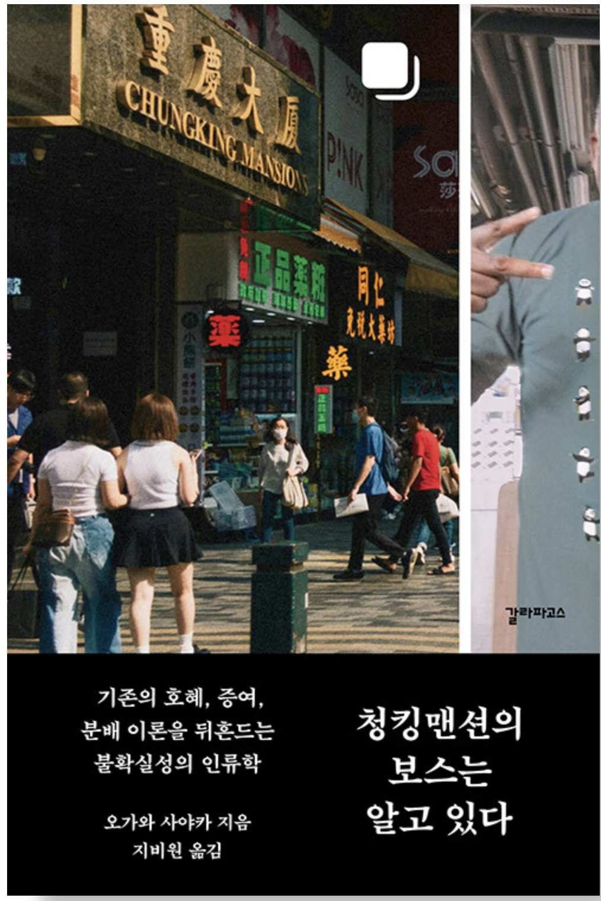
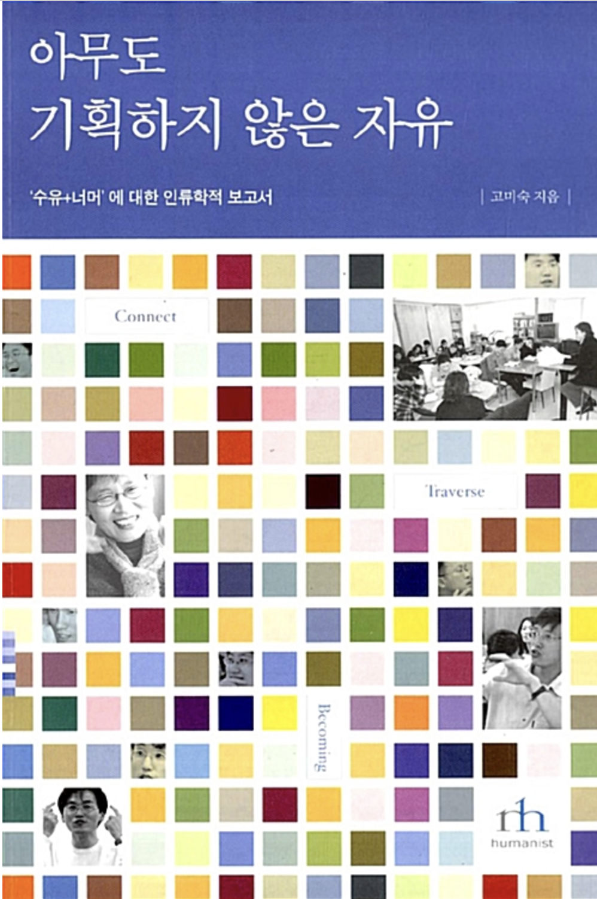
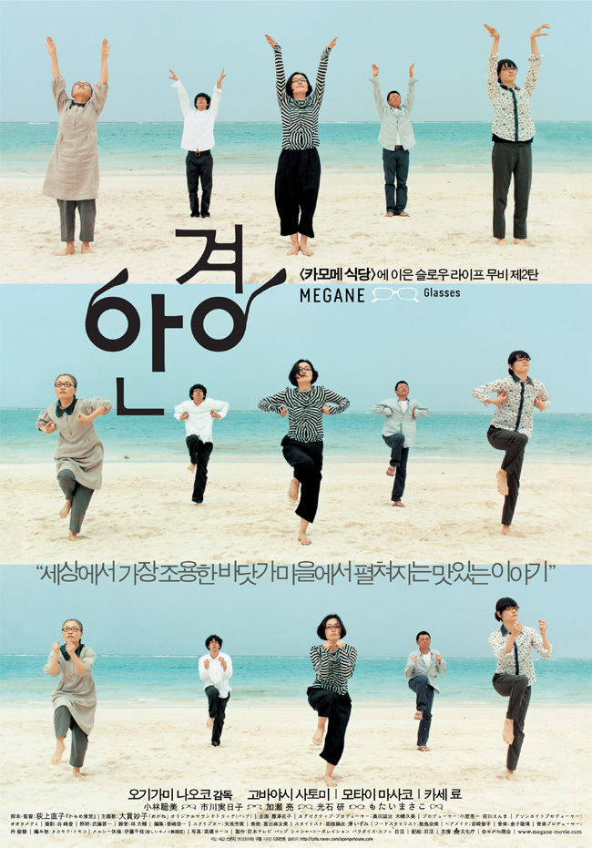

내 세대 사람들은 청소년기에 홍콩 영화를 보며 자랐다. 그래서인지 홍콩 이야기가 나오면 유난히 관심이 간다.

책 《청킹맨션의 보스는 알고 있다》는 도서상품권으로 어떤 책을 살까 하고 서점에서 고르다가, 제목에 '청킹(重慶)'이라는 단어가 들어 있다는 이유만으로 샀다. 왕가위 감독의 기념비적인 영화 《중경삼림》(Chungking Express)에 등장하는 바로 그 중경이다.

일본인 문화인류학자 오가와 사야카가 홍콩의 청킹맨션이라는 저렴한 숙박시설에 머물며, 그곳을 중심으로 경제활동을 하는 탄자니아인들을 관찰하고 쓴 책이다. 자칭 '청킹맨션의 보스'라는 카라마를 중심으로 아프리카인들이 어떻게 네트워크를 유지하고, 돈을 벌고, 아프리카의 여러 나라와 교역하는지를 그리는데… 재미있다.

이들은 느슨한 관계 속에서, 어떻게 보면 '겸사겸사'의 철학으로 서로 협력해 나간다. 때로는 배신을 당해 큰 손해를 보기도 하지만, 그렇다고 '너구리' 같은 능글함을 잃지는 않는다. 여전히 느슨한 관계 속에서 사업을 이어 간다.

이들을 움직이는 것은 어떤 공식적인 제도가 아니다. 관계는 자연스럽게 만들어졌고, 때로는 기존의 시스템을 대체하기도 한다. 책에 등장하는 비공식 해외 송금 시스템이 그런 사례다.

책을 읽다 보니 예전에 '수유+너머'를 만들어 운영했던 고미숙 박사님이 생각났다. 이 공동체의 생활을 기록한 책이 바로 《아무도 기획하지 않은 자유》였다. (지금은 절판되어 동네 도서관에서나 찾아봐야 한다.)

소위 고학력 백수(?)들이 모여 만든 이 공동체에서도 사람들은 서로 지식을 주고받으며 살아간다. 식사는 당번제로 해결하고, 누구든 공유하고 싶은 주제가 있으면 발제하여 모임을 열면 된다. 물론 주제에는 제약이 없다.

예전에 나도 이 모임에 몇 번 가 본 적이 있다. 하지만 당시 백수가 아니었던 나로서는 그 안으로 깊이 발을 들일 용기가 부족했다.

여기서 또 꼬리를 물고 떠오르는 것은 일본 영화 《안경》(Megane)이다. 개인적으로 나는 세상의 모든 영화상을 이 영화에 줘야 한다고 생각한다. 볼 때마다 마음이 편안해지는 영화다.

이 영화에도 일종의 공유경제가 등장한다. 영화의 배경이 되는 섬(?)에서 지도자 같은 존재인 사쿠라 씨는 팥빙수를 내어 주는데, 돈을 받고 파는 것이 아니다. 일종의 물물교환이다. 사람들이 농산물이나 자신에게 가치가 있다고 생각되는 물건을 가져오면, 그것을 받고 팥빙수를 내어 준다.

그리고 펜션 하마다를 중심으로 느슨한 네트워크가 형성된다. 누구도 강제하지 않지만 자연스럽게 규칙이 만들어지고, 사람들은 그 규칙을 따른다. (메르시 체조, 사색, 공동 식사 등등.)

청킹맨션의 아프리카인 네트워크, 수유+너머, 그리고 영화 《안경》을 보면 한 가지 생각이 든다.

우리는 사회 시스템 안에서 살아가고 있지만, 마음 한편으로는 그 시스템을 지겨워하고 벗어나고 싶어 하는 욕망을 품고 있는 게 아닐까.

이런 욕망을 좇는 사람들은 게릴라처럼 스스로 시스템을 만들고, 없애고, 바꾸어 가며 살아간다.

아니다.

어쩌면 애초에 그렇게 살아갈 수밖에 없는 사람들이 제도권의 눈을 피해 자신들만의 시스템을 만들어 살아가는 것인지도 모르겠다.

겸사겸사, 말이다.