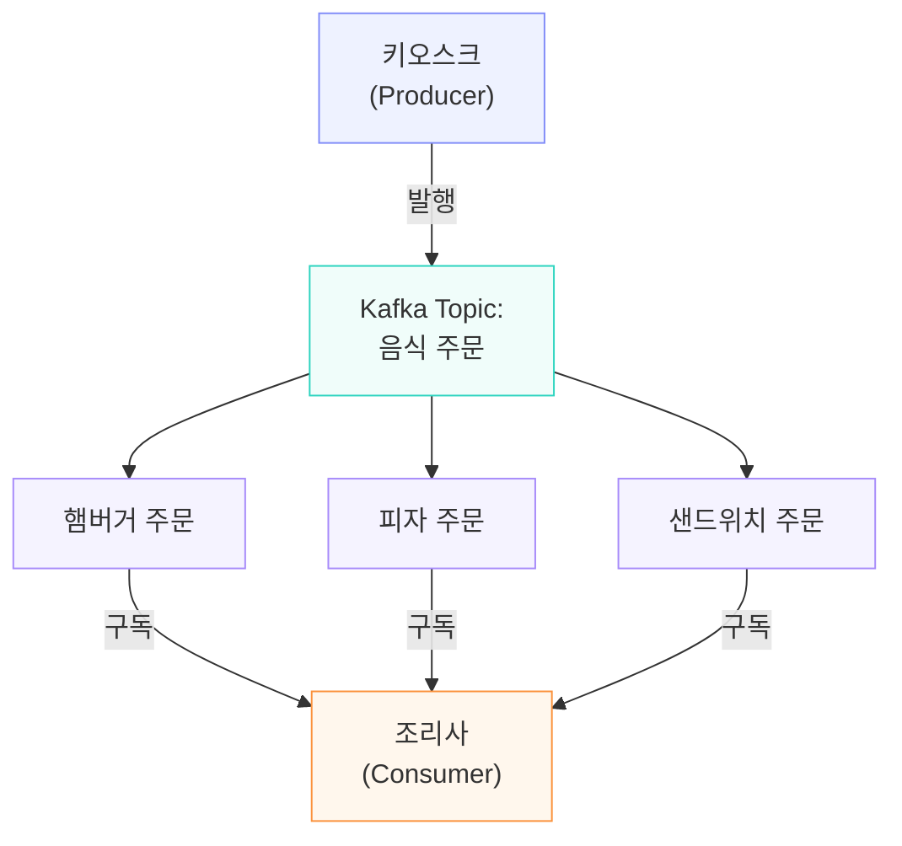
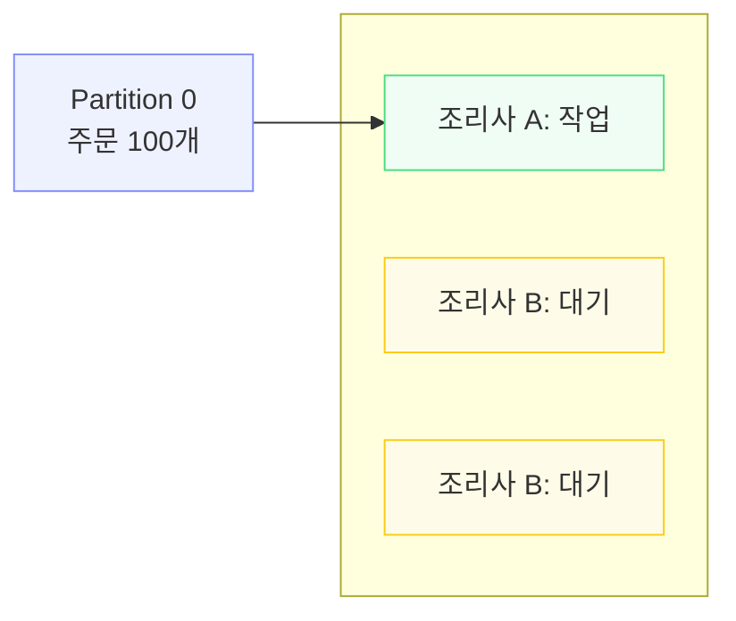
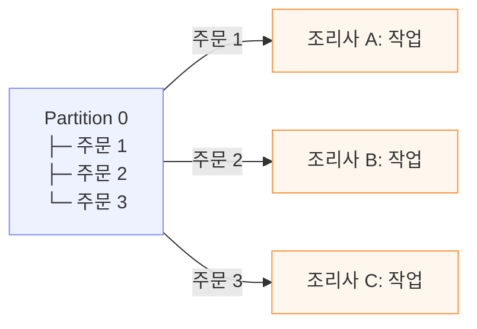

# GPT와의 대화..

kafka Share Group이라는 키워드를 어제 처음 접했다. 이를 알아보기 위해 GPT와 대화를 좀 했는데 내가 Kafka의 파티션이라는 개념을 더 궁금해 했다는 결과가 나왔다. 일일이 정리하려다가 그냥 대화를 통째로 기록하는게 더 나을 것 같아서(귀찮아서) 통째로 적는다 


# Kafka Share Group과 Partition에 관한 대화 기록

> 이 문서는 2026년 11월 4일까지 나눈 Kafka 관련 질문과 답변을 순서대로 정리한 Markdown 기록입니다. 화면의 그림과 인터랙티브 퀴즈는 Markdown에서 읽을 수 있도록 텍스트·표로 변환하고, 일부 중복 문장은 정리했습니다.
>
> **대화 주제:** Kafka의 기본 구성 → Share Group과 Consumer Group 비교 → Topic/Partition/Message 관계 → Partition 수 설정 → 음식 종류와 Partition의 관계

---

## 1. Kafka의 Share Group이란?

**사용자:** kafka의 share group에 대해 고등학생도 알기 쉬울 정도로 설명을 해 줘

**ChatGPT:**

### Apache Kafka의 Share Group이란?

**Kafka의 Share Group은 여러 소비자(Consumer)가 메시지를 하나씩 나누어 처리하도록 만든 새로운 기능입니다.**

2025년 Kafka 4.0에서 처음 등장했고, Kafka 4.2부터 운영 환경에서 사용할 수 있는 정식 기능이 되었습니다. 기술적으로는 **KIP-932: Queues for Kafka**라고 부릅니다.

고등학생도 이해할 수 있도록 **학교 급식 주문 처리**에 비유해 설명하겠습니다.

### 1-1. 먼저 Kafka는 무엇일까?

학교 매점에서 학생 100명이 음식을 주문한다고 생각해 봅시다. 주문이 들어올 때마다 조리사에게 직접 전달하는 대신, 주문 내용을 게시판에 적어 놓습니다.

- **Producer(생산자):** 주문을 접수하는 키오스크
- **Kafka:** 주문을 저장하는 시스템
- **Topic(토픽):** '음식 주문'이라는 게시판
- **Consumer(소비자):** 주문을 가져와 음식을 만드는 조리사
- **Message(메시지):** '햄버거 1개', '샌드위치 2개' 같은 주문


Kafka는 이렇게 메시지를 저장해 놓고, 프로그램들이 메시지를 가져가 처리할 수 있게 해 주는 시스템입니다.





### 1-2. 기존 Consumer Group의 제약

이번에는 조리사가 3명 있다고 가정하겠습니다.

기존 Kafka에는 중요한 규칙이 있습니다.

**같은 Consumer Group에서는 하나의 Partition을 동시에 한 Consumer만 담당합니다.**

여기서 Partition은 게시판을 나누어 놓은 구역이라고 생각하면 됩니다.

만약 주문 게시판이 하나의 구역(Partition 1개)으로만 구성되어 있다면 어떻게 될까요?





주문이 100개나 쌓여 있어도 조리사 A만 일을 합니다. 조리사 B와 C를 더 투입해도 주문 처리 속도는 빨라지지 않습니다.

물론 Partition을 3개로 늘리면 조리사 3명이 각각 맡아서 일할 수 있습니다. 하지만 **Partition이 3개라면 같은 Consumer Group에서 동시에 Partition을 담당할 수 있는 Consumer도 최대 3개**라는 제약이 있습니다.

바로 이 제약을 해결하는 것이 Share Group입니다.

### 1-3. Share Group은 무엇이 다를까?

Share Group에서는 하나의 Partition에 들어 있는 메시지들을 여러 Consumer가 나누어 처리할 수 있습니다.





예를 들어 A가 햄버거를 만들고, B가 피자를 만들고, C가 샌드위치를 만드는 것입니다.

이 방식이라면 Partition이 1개여도 Consumer 10개, 20개를 투입할 수 있습니다. 실제 처리 속도는 메시지 수와 작업량, 자원 등에 따라 달라지지만, **Partition 개수가 Consumer 수를 제한하지 않게 됩니다.**

### 1-4. 조리사가 일을 하다 실패하면?

Share Group에는 또 하나의 중요한 기능이 있습니다. 바로 **메시지 처리 성공 여부를 Kafka에 알려주는 기능(Acknowledgement, ACK)**입니다.

예를 들어 조리사 A가 햄버거 주문을 가져갔는데, 갑자기 조리 기계가 고장 났다고 가정해 봅시다.

1. 주문이 Kafka에 도착합니다.
2. 조리사 A가 주문을 가져갑니다. 다른 조리사가 같은 주문을 동시에 가져가지 못하도록 잠시 잠급니다(Lock).
3. 처리가 성공하면 `ACCEPT`로 완료를 알립니다.
4. 다시 처리해야 하면 `RELEASE`를 통해 재시도를 허용합니다.
5. 처리할 수 없는 메시지는 `REJECT`로 거부할 수도 있습니다.
6. 재처리 가능 상태가 된 주문은 조리사 B 등이 가져갈 수 있습니다.

Share Group은 메시지를 가져간 Consumer에게 일정 시간 동안 잠금(Lock)을 부여합니다. 기본 잠금 시간은 30초이며 설정으로 바꿀 수 있습니다. 잠금 시간이 지날 때까지 처리를 완료하지 못하면 해당 메시지를 다시 다른 Consumer가 가져갈 수 있습니다.

단, 재전달이 가능하므로 같은 메시지가 두 번 처리되지 않게 만드는 설계도 중요합니다.

### 1-5. Consumer Group과 Share Group의 차이

| 구분 | Consumer Group | Share Group |
|---|---|---|
| 작업 배분 단위 | Partition | 개별 메시지 |
| Partition 1개에 Consumer 3개 | 1개만 담당 | 3개 모두 처리 가능 |
| Consumer 개수 제한 | Partition 수에 영향받음 | Partition 수보다 많아도 됨 |
| 처리 순서 보장 | Partition 내 순서 유지에 적합 | 실제 처리 완료 순서가 달라질 수 있음 |
| 처리 완료 확인 | 주로 Offset 관리 | 메시지별 ACK |
| 주요 활용 | 순서가 중요한 데이터 흐름 | 여러 작업자가 나누어 처리하는 작업 |

### 1-6. 그럼 모든 Kafka를 Share Group으로 바꾸면 좋을까?

그렇지는 않습니다. Share Group에는 중요한 단점이 있습니다. **메시지 처리 순서가 보장되지 않는다는 점입니다.**

예를 들어 은행 계좌에서 다음 두 사건이 발생했다고 생각해 봅시다.

1. 10만 원 입금
2. 5만 원 출금

순서대로 처리해야 하는 업무라면 기존 Consumer Group이 더 적합할 수 있습니다.

반면 이미지 100장을 압축하는 작업이라면 첫 번째 이미지를 먼저 압축하든, 열 번째 이미지를 먼저 압축하든 상관없습니다. 이런 경우에는 Share Group이 적합합니다.

- **Consumer Group이 적합한 경우:** 거래 기록 처리, 사용자별 이벤트 분석, 순서가 중요한 로그 처리
- **Share Group이 적합한 경우:** 이미지 변환, 이메일 발송 작업, 문서 분석, AI 추론 요청을 여러 작업자에게 분배하는 경우

### 1-7. 이해도 확인 퀴즈

**문제:** Topic에 Partition이 2개 있고 Consumer가 5개 있습니다. Share Group을 사용하면 최대 몇 개의 Consumer가 메시지 처리에 참여할 수 있을까요?

- A. 2개
- B. 3개
- C. 5개

**정답: C. 5개.** Share Group은 하나의 Partition을 여러 Consumer가 공유하므로 5개 모두 메시지 처리에 참여할 수 있습니다.

**한 문장으로 정리하면, Consumer Group은 게시판 구역을 나눠 맡는 방식이고, Share Group은 게시판에 적힌 개별 작업을 여러 사람이 함께 나누어 처리하는 방식입니다.**

Share Group의 등장으로 Kafka는 기존의 스트림 처리뿐 아니라 RabbitMQ 같은 메시지 큐가 자주 맡던 작업 분배 용도로도 활용하기 쉬워졌습니다. 단, Kafka의 모든 동작이 일반적인 메시지 큐와 같아진 것은 아닙니다.

공식 설계 문서: [KIP-932: Queues for Kafka](https://cwiki.apache.org/confluence/spaces/KAFKA/pages/255070434/KIP-932%2BQueues%2Bfor%2BKafka)

---

## 2. Partition은 게시판에 해당하나?

**사용자:** kafka의 파티션이라는 개념이 그럼 예를 든 것 중에서 게시판에 해당된다고 보면 돼?

**ChatGPT:**

거의 맞습니다. 다만 정확히 구분하면 **게시판 전체는 Topic이고, 게시판을 나눈 각각의 구역이 Partition**입니다.

학교 급식 주문을 다시 예로 들어보겠습니다.

- **Topic:** 주문을 기록하는 게시판 전체
- **Partition:** 게시판을 나눈 각각의 구역
- **Message:** 게시판에 적힌 개별 주문
- **Consumer:** 주문을 가져가 처리하는 조리사

```text
Topic: 음식 주문 게시판
┌─────────────────────────────────────────────┐
│ Partition 0  │ Partition 1  │ Partition 2  │
├──────────────┼──────────────┼──────────────┤
│ 주문 1       │ 주문 4       │ 주문 7       │
│ 주문 2       │ 주문 5       │ 주문 8       │
│ 주문 3       │ 주문 6       │ 주문 9       │
└─────────────────────────────────────────────┘
```


| Partition0                  | Partition 1                 | Partion2                    |
| --------------------------- | --------------------------- | --------------------------- |
| 주문1<br />주문2<br />주문3 | 주문4<br />주문5<br />주문6 | 주문7<br />주문8<br />주문9 |


위 메시지 배치는 이해를 돕기 위한 예시입니다.

여기서 중요한 것은 **Partition은 단순히 공간을 나누는 개념이 아니라, 메시지를 순서대로 저장하는 단위**라는 점입니다.

예를 들어 Partition 0에 주문 1, 4, 7이 순서대로 들어왔다면 이 순서가 유지됩니다. 하지만 Partition 0과 Partition 1 사이의 전체적인 메시지 순서는 보장되지 않습니다.

그리고 앞서 이야기한 차이는 다음과 같습니다.

- **기존 Consumer Group:** 게시판의 각 구역(Partition)을 조리사 한 명이 전담
- **Share Group:** 같은 구역(Partition)의 주문을 여러 조리사가 나눠 처리 가능

즉, Kafka를 이해할 때는 다음 관계를 기억하면 좋습니다.

**Topic → Partition → Message**

이 구조를 이해하면 Kafka에서 왜 Partition 개수가 처리 병렬성에 영향을 주는지, 그리고 Share Group이 왜 중요한 변화인지 자연스럽게 이해할 수 있습니다.

---

## 3. Topic의 Partition 개수는 어떻게 정하나?

**사용자:** 그럼 Topic에서 파티션의 갯수는 어떻게 정하나?

**ChatGPT:**

Kafka에서 **Topic의 Partition 개수는 개발자나 시스템 관리자가 정합니다.** Kafka가 메시지 수에 따라 자동으로 Partition을 늘리는 것이 기본 동작은 아닙니다.

그런데 Partition을 몇 개로 정할지는 꽤 중요한 설계 문제입니다. 왜냐하면 **Partition 개수에 따라 동시에 처리할 수 있는 작업의 양과 데이터 처리 순서가 달라지기 때문**입니다.

### 3-1. Partition 개수는 누가, 언제 정하나?

예를 들어 `food-orders`라는 Topic을 만든다고 가정하겠습니다.

Topic을 생성할 때 Partition을 3개로 지정하면 Kafka 내부에는 다음과 같은 구조가 만들어집니다.

| Partition0 | Partition 1 | Partion2   |
| ---------- | ----------- | ---------- |
| 메시지저장 | 메시지저장  | 메시지저장 |

Partition 개수를 따로 지정하지 않으면 Kafka의 기본 설정값에 따라 생성됩니다. 관리자는 처음부터 개수를 지정하거나 나중에 늘릴 수도 있습니다.

### 3-2. 그럼 Partition은 몇 개가 적당할까?

가장 중요한 기준 중 하나는 **Consumer들이 얼마나 많은 메시지를 동시에 처리해야 하는가**입니다.

기존 Consumer Group을 사용할 때 다음 예를 보겠습니다.

| Partition 수 | Consumer 수 | 실제 작업 가능한 Consumer |
|---|---|---|
| 1개 | 5개 | 1개 |
| 3개 | 5개 | 최대 3개 |
| 5개 | 5개 | 최대 5개 |
| 10개 | 5개 | 최대 5개 |

Partition이 3개라면 같은 Consumer Group에 Consumer가 5개 있어도 최대 3개만 각 Partition을 담당할 수 있습니다.

반대로 Partition을 10개 만들고 Consumer가 5개라면 한 Consumer가 Partition 2개씩 담당할 수 있습니다.

따라서 일반적인 Consumer Group에서는 **동시에 동작해야 할 Consumer 수를 고려해 Partition 개수를 결정**합니다.

다만 Consumer 수만이 기준은 아닙니다. 메시지 생산량, 처리 속도, 서버 자원, 메시지 순서 보장 요구사항도 함께 고려해야 합니다.

### 3-3. 실제로는 처리량을 측정해서 결정한다

예를 들어 음식 주문이 초당 600개 들어온다고 가정하겠습니다.

성능 테스트를 해 보니 Consumer 하나가 초당 100개의 주문을 처리할 수 있습니다.

이론적으로 필요한 Consumer 수는 다음과 같습니다.

```text
초당 주문 600개 ÷ Consumer당 처리량 100개 = Consumer 6개
```

따라서 기존 Consumer Group을 이용한다면 최소 6개의 Partition이 필요합니다. 실제로는 부하 증가와 장애에 대비해 여유를 두고 결정합니다.

단, Partition 수를 늘린다고 처리 속도가 무조건 비례해서 증가하는 것은 아닙니다. Kafka 서버, 네트워크, 데이터베이스 등의 성능도 영향을 줍니다.

### 3-4. Partition은 많을수록 좋은가?

그렇지는 않습니다.

Partition을 많이 만들면 병렬 처리에 유리하지만, 각 Partition을 관리하기 위한 메모리·파일·네트워크 등의 자원도 더 필요합니다.

또한 주문을 어느 Partition에 넣을지도 중요합니다.

예를 들어 같은 학생이 주문한 내용을 순서대로 처리해야 한다면, **학생 ID를 메시지의 Key로 지정해 같은 Partition에 보내도록 설계**할 수 있습니다.

다만 나중에 Partition 수를 늘리면 같은 Key가 이전과 다른 Partition에 배치될 수 있으므로 순서 보장에 주의해야 합니다.

### 3-5. Partition 개수를 나중에 바꿀 수 있을까?

네. 처음 3개로 만들었다가 6개로 늘릴 수 있습니다.

Kafka 명령어로는 다음과 같이 작성합니다.

```bash
# Topic 생성: Partition 3개
kafka-topics.sh --create \
  --topic food-orders \
  --bootstrap-server localhost:9092 \
  --partitions 3 \
  --replication-factor 1

# Partition을 총 6개로 증가
kafka-topics.sh --alter \
  --topic food-orders \
  --bootstrap-server localhost:9092 \
  --partitions 6
```

여기서 `replication-factor 1`은 단일 서버 학습용 예시입니다.

**주의할 점은 Partition 개수를 늘리는 것은 가능하지만, 기존 Topic에서 직접 줄이는 것은 지원하지 않는다는 것입니다.**

### 3-6. 그렇다면 Share Group에서는?

Share Group이 등장하면서 Partition 개수를 정하는 기준도 달라졌습니다.

| 구분 | 기존 Consumer Group | Share Group |
|---|---|---|
| Consumer 10개 사용 | 최대 병렬성을 위해 Partition 10개 이상 필요 | Partition 1개여도 10개 Consumer 참여 가능 |
| Partition 수 결정 | Consumer 병렬성에 큰 영향 | 메시지 저장·읽기·쓰기 처리량 중심 |
| 설계의 핵심 | Partition 수와 Consumer 수 | 데이터 처리량과 작업 분배 |

Share Group에서는 Partition 하나를 여러 Consumer가 공유할 수 있기 때문에 **Consumer 수를 늘리기 위해 반드시 Partition 수도 늘려야 하는 제약이 사라집니다.**

이 부분이 Share Group의 중요한 변화입니다.

결국 Kafka의 Partition 수는 기존에는 **메시지를 얼마나 빠르게 저장할 것인가 + Consumer를 얼마나 병렬로 실행할 것인가**를 고려했다면, Share Group에서는 Consumer의 병렬성을 Partition 개수와 분리해서 설계할 수 있게 된 것입니다.


## 4. 음식 종류별로 Partition이 나뉜다고 이해하면 될까?

**사용자:** 아까 음식 주문 예시에서 음식 주문 게시판이 Topic이라고 했어.. 그럼 햄버거 주문, 피지주문, 샌드위치 주문은 각각 Partition으로 이해하면 될 까?

**ChatGPT:**

그렇게 이해할 수도 있지만, **Kafka의 실제 구조에서는 햄버거 주문, 피자 주문, 샌드위치 주문이 반드시 각각의 Partition이 되는 것은 아닙니다.**

### 4-1. Topic, Partition, Message 구분

- **Topic:** 음식 주문 게시판 전체 (`food-orders`)
- **Partition:** 게시판을 나눈 저장 구역
- **Message:** 개별 음식 주문 (예: `햄버거 1개`, `피자 2개`)

```text
Topic: food-orders
│
├── Partition 0
│   ├── 햄버거 1개
│   ├── 피자 2개
│   └── 샌드위치 1개
│
├── Partition 1
│   ├── 피자 1개
│   ├── 햄버거 2개
│   └── 피자 3개
│
└── Partition 2
    ├── 샌드위치 2개
    ├── 햄버거 1개
    └── 피자 1개
```

하나의 Partition에 **여러 종류의 음식 주문이 섞여 들어갈 수 있습니다.** Partition은 음식 종류에 따라 자동으로 생성되는 것이 아닙니다.

### 4-2. 음식 종류별로 Partition을 나눌 수는 있을까?

개발자가 Producer의 분배 규칙을 설계하면 가능합니다. 예를 들어 아래처럼 의도할 수 있습니다.

| Partition | 저장하려는 주문 유형 |
|---|---|
| Partition 0 | 햄버거 주문 |
| Partition 1 | 피자 주문 |
| Partition 2 | 샌드위치 주문 |

단, 위 표처럼 **음식 종류와 Partition을 정확하게 일대일로 대응**시키려면 그에 맞는 분배 규칙이 필요합니다.

메시지의 `Key`를 음식 종류로 설정하면 **같은 Key가 일반적으로 같은 Partition으로 전송**되지만, 서로 다른 Key들이 반드시 서로 다른 Partition에 배치되는 것은 아닙니다. Key를 설정하는 것만으로 위 표가 보장되는 것은 아닙니다.

### 4-3. Partition을 어떤 기준으로 나누는가?

Partition의 목적은 **메시지를 분산 저장하고 병렬 처리하기 위해서**입니다. 분배 기준으로는 음식 종류, 학생(고객) ID, 주문 번호 등을 사용할 수 있고, Key가 없는 경우 Producer의 분배 방식에 따라 배치할 수도 있습니다.

**세 가지 핵심 질문**

- **Topic:** 어떤 종류의 데이터를 저장할 것인가?
- **Partition:** 그 데이터를 어떻게 나누어 저장할 것인가?
- **Message:** 실제로 저장되는 개별 데이터는 무엇인가?

또한 **동일 Partition 내부의 메시지 순서는 보장되지만 서로 다른 Partition 사이의 전체 순서는 보장되지 않습니다.** 그래서 같은 고객의 주문 이벤트를 순서대로 처리해야 하는 시스템이라면 `고객 ID`를 Key로 지정하는 설계를 고려할 수 있습니다. 다만 Partition 개수를 변경하면 Key의 Partition 매핑이 바뀔 수 있다는 점을 주의해야 합니다
