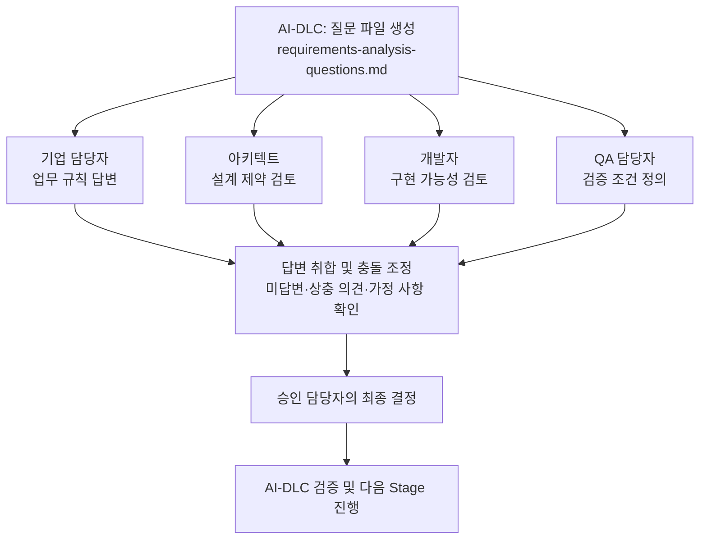

# GPT와의 대화..

이번에는 AWS에서 제창한 AIDLC에 대해 내용을 GPT에 물어보고 정리를 시킨 것이다. 다음은 세번째. 이 페이지가 핵심이다. 


# AI-DLC v2의 질문 파일과 다중 이해관계자 협업

네. **그렇게 이해하셔도 됩니다.** AI-DLC가 질문을 Markdown(`.md`) 파일로 생성하고 사람이 답변하도록 하는 구조는 단순한 AI와 개발자의 질의응답을 넘어, **기획자, 도메인 전문가, 아키텍트, 개발자, QA 담당자 등 여러 이해관계자가 개발 과정에 참여할 수 있는 접점**을 제공합니다.

다만 한 가지는 구분해야 합니다.

- **AI-DLC가 기본적으로 지원하는 기능:** 단계별 질문 파일 생성, 사람의 답변 기록, 결과물 검토 및 승인
- **이를 확장해서 활용할 수 있는 기능:** 관계자별 질문 배분, 공동 검토, 복수 담당자의 승인 절차

첫 번째는 AI-DLC v2의 기본적인 상호작용 방식이며, 두 번째는 Git이나 협업 시스템 등을 결합하여 구현할 수 있는 활용 방식입니다.

## 1. 질문 파일이 협업 수단이 될 수 있는 이유

AI-DLC v2에서는 사용자 입력이 필요한 Stage에서 일반적으로 `{stage-name}-questions.md` 형식의 질문 파일을 생성합니다.

사용자는 질문을 대화형으로 처리하거나, 직접 파일을 편집하거나, 채팅으로 답변할 수 있습니다. 이 질문 파일을 답변을 관리하는 기준 기록으로 활용할 수 있습니다.

예를 들어 요구사항 분석 단계에서 다음과 같은 파일이 만들어졌다고 가정하겠습니다.

**`requirements-analysis-questions.md` — 설명을 위한 간략화된 예시**

```markdown
# 요구사항 확인 질문

## Q1. [Product Owner] 회원가입은 어떤 방식으로 제공하나요?
- A. 이메일 가입만 지원
- B. 이메일 및 소셜 로그인 지원
- X. 기타

[Answer]: B

## Q2. [Architect] 인증 세션은 어떻게 관리할까요?
- A. 서버 세션 기반
- B. 토큰 기반
- X. 기타

[Answer]: A

## Q3. [QA] 중복 가입을 어떻게 처리할까요?
- A. 중복 계정 생성 거부
- B. 기존 계정 확인 절차 안내
- X. 기타

[Answer]: (미작성)
```

실제 v2의 질문 프로토콜에서도 `[Developer]`처럼 답변할 전문 역할을 질문 제목에 명시하는 방식을 볼 수 있습니다.

이 점이 특히 흥미롭습니다. 질문 파일을 단순한 AI 프롬프트가 아니라, 담당 분야별로 검토할 수 있는 **구조화된 의사결정 문서**로 활용할 수 있기 때문입니다.

## 2. 5개 Phase에 여러 관계자를 참여시킨다면?

AI-DLC v2의 개발 생명주기에 다음처럼 역할을 배치할 수 있습니다.

| Phase                 | 참여 가능한 관계자          | 주요 검토 내용            |
| --------------------- | --------------------------- | ------------------------- |
| **0. Initialization** | 개발 리더, DevOps           | 기술 환경, 프로젝트 규칙  |
| **1. Ideation**       | 고객, 기획자, 도메인 전문가 | 비즈니스 목표, 개발 범위  |
| **2. Inception**      | PO, 아키텍트, 개발자, QA    | 요구사항, 품질 속성, 설계 |
| **3. Construction**   | 개발자, 아키텍트, QA        | 구현 정책, 테스트, 품질   |
| **4. Operation**      | DevOps, 운영팀, 보안 담당자 | 배포, 모니터링, 장애 대응 |

> 이 표는 **AI-DLC 기본 제공 역할 배정표가 아니라 협업 프로세스를 설계한 예시**입니다. 모든 Stage에서 질문 파일이 생성되는 것도 아닙니다.

특히 Inception의 요구사항 분석과 아키텍처 설계 단계에서 이러한 참여 방식이 효과적일 수 있습니다.

## 3. 실제 협업 프로세스로 확장한다면

예를 들어 기업 연계 프로젝트에서 다음과 같은 흐름을 만들 수 있습니다.



Git을 이용해 질문 파일을 공유하고, 관계자들이 Pull Request 등을 통해 답변을 제안하도록 구성할 수 있습니다.

질문 파일은 다음과 같은 기능을 하게 됩니다.

- 요구사항 협의 기록
- 업무 규칙에 대한 의사결정 기록
- 관계자 간 의견 차이 확인
- 변경 사유 추적
- 이후 테스트 및 설계 검토의 근거 자료

Stage 산출물과 감사 기록을 버전 관리하는 AI-DLC의 구조는 이러한 활용과 잘 맞습니다.

## 4. 다만, 중요한 제약이 있습니다

**질문 파일을 여러 사람이 편집할 수 있다는 것과 AI-DLC가 다중 사용자 승인 시스템을 기본 제공한다는 것은 다릅니다.**

**첫째, 역할 표시는 곧 권한 검증이 아닙니다.**

질문에 `[Architect]`, `[QA]` 등의 역할이 적혀 있더라도 엔진이 해당 역할의 실제 사용자 신원을 확인하여 권한을 강제하는 것은 아닙니다.

**둘째, 답변 작성과 Stage 승인은 다릅니다.**

질문 파일에 답변을 작성하는 것만으로 Stage가 자동 승인되는 것은 아닙니다. AI-DLC의 답변 확인과 별도 승인 게이트를 구분해야 하며, 승인 기록 자체가 조직 차원의 신원 인증을 보장하는 것도 아닙니다.

**셋째, 공동 편집 시 충돌 관리가 필요합니다.**

여러 사람이 동시에 동일한 Markdown 파일을 수정한다면 Git 충돌 관리나 검토 프로세스가 필요합니다.

따라서 기업 프로젝트에 활용하려면 **질문 작성자, 답변 담당자, 최종 승인자를 분리**하고, Git의 리뷰·승인 기능 등을 함께 사용하는 것이 바람직합니다.

## 5. 소프트웨어 공학 관점에서 갖는 의미

기존에는 요구사항 분석, 아키텍처 설계, 테스트 설계가 서로 다른 문서와 회의에서 독립적으로 진행되기 쉬웠습니다.

반면 AI-DLC에서는 구조화된 질문과 답변을 통해 각 업무 분야의 의사결정을 기록하고, 그 결과를 다음 Stage의 입력으로 사용할 수 있습니다.

이는 다음과 같은 구조로 발전시킬 수 있습니다.

**요구사항 질문 → 담당자 답변 → 의사결정 확정 → 설계 반영 → 테스트 조건 도출 → 검증 결과 추적**

물론 이 연결 관계가 모두 자동으로 보장되는 것은 아니며, 검증 및 추적 체계를 추가로 설계해야 합니다.

### 공식 참고 자료

- [AI-DLC Interaction Modes](https://awslabs.github.io/aidlc-workflows/guide/07-interaction-modes/)
- [AI-DLC Artifacts Reference](https://awslabs.github.io/aidlc-workflows/guide/14-artifacts-reference/)

---

## 제안하고 싶은 활용 방향

부트캠프의 기업 연계 프로젝트에 AI-DLC를 적용한다면 단순히 개발자들이 `$aidlc`를 실행하는 것에서 끝내지 않고, **기업 담당자와 교육생이 함께 질문 파일을 검토하는 요구사항 협업 프로세스**를 만들 수 있을 것입니다.

이때 AI는 요구사항 분석과 질문 생성을 담당하고, 기업 담당자는 업무적 타당성을 확인하며, 교육생은 설계와 구현 가능성을 검토하고, QA 역할의 참여자는 검증 가능성을 확인하도록 구성할 수 있습니다.

결국 AI-DLC의 질문 파일을 **Human-in-the-Loop를 실현하는 협업 인터페이스**로 바라보는 것입니다.

이러한 관점은 AI-DLC를 단순한 AI 코딩 방법론이 아니라 **AI와 여러 이해관계자가 공동으로 소프트웨어를 개발하는 방법론**으로 설명할 수 있는 좋은 출발점이 됩니다.
